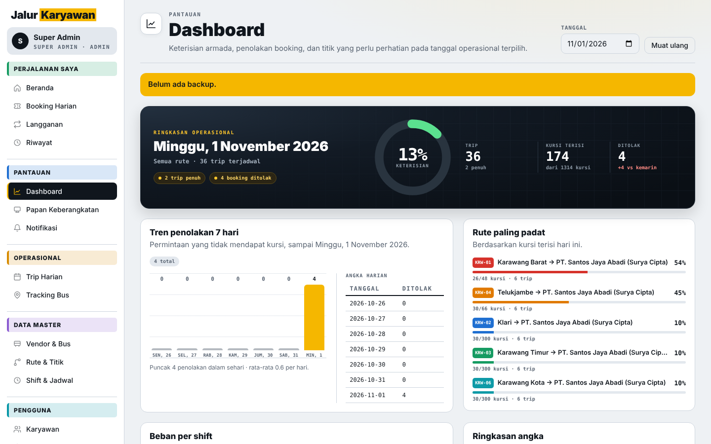
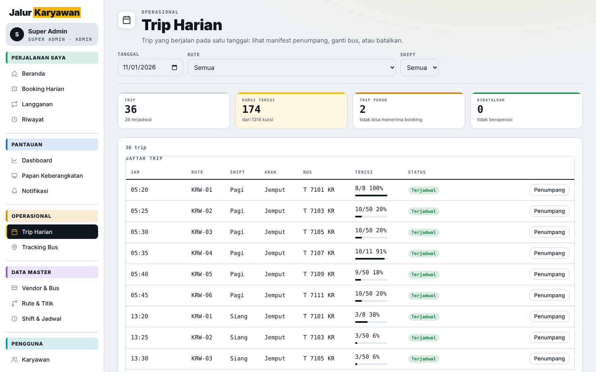
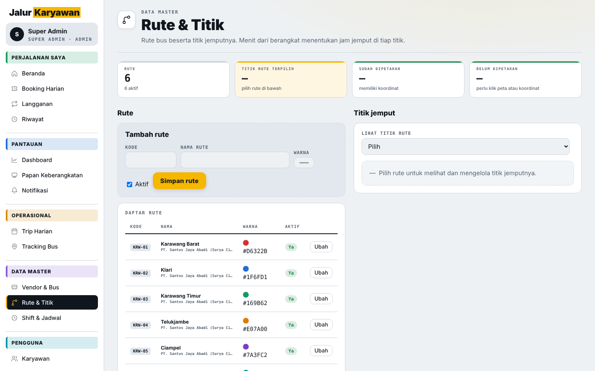
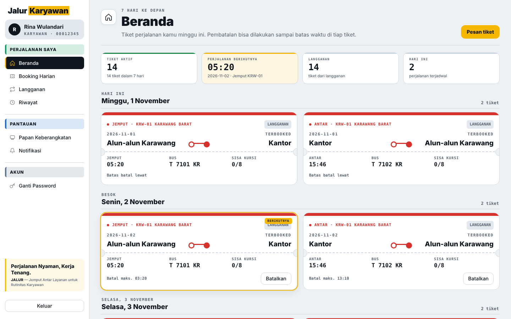
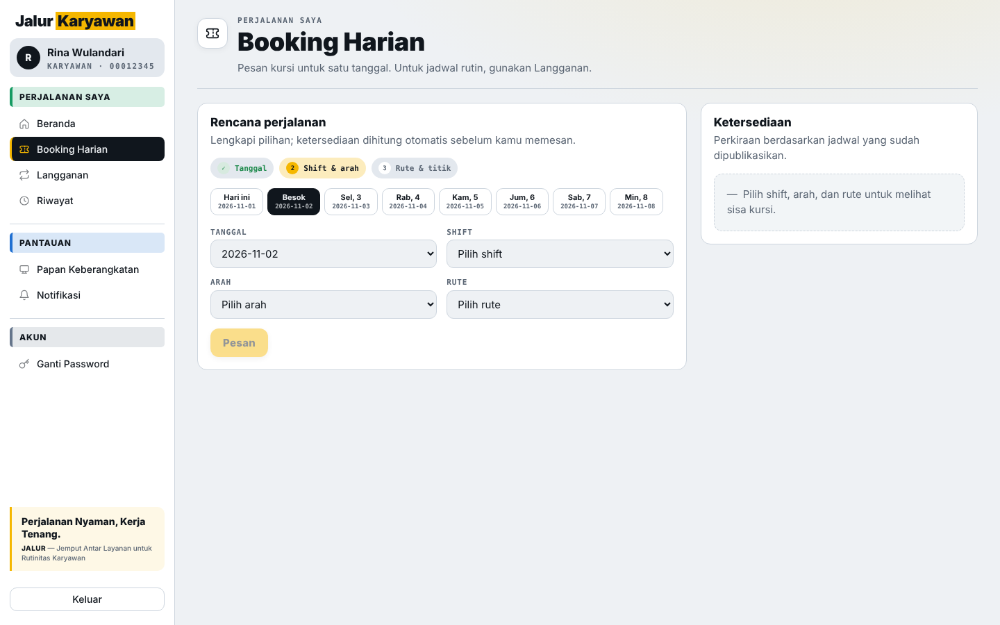
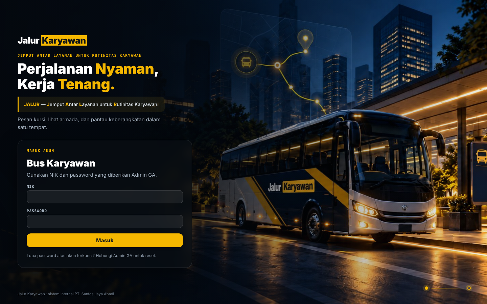
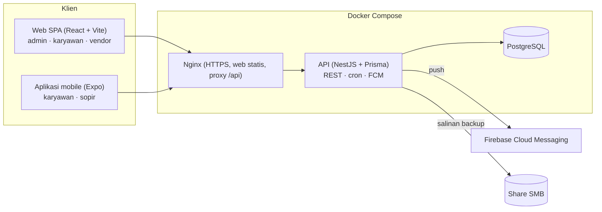

# Jalur Karyawan

[English](README.md) · **Bahasa Indonesia**

Jalur Karyawan (nama internal: Bus Management System, BMS) mengatur jadwal dan pemesanan bus antar-jemput karyawan. Karyawan memesan kursi di rute tetap per shift dari web atau aplikasi mobile, sopir melakukan check-in penumpang dengan QR code dan membagikan posisi GPS, vendor melihat tingkat keterisian, dan tim GA mengelola bus, rute, shift, serta trip. Sistem dirancang untuk satu lokasi dengan sekitar 2.500 karyawan, 50 bus, dan tiga shift. Antarmukanya berbahasa Indonesia.


## Daftar isi

- [Tangkapan layar](#tangkapan-layar)
- [Fitur](#fitur)
- [Peran pengguna](#peran-pengguna)
- [Arsitektur](#arsitektur)
- [Teknologi](#teknologi)
- [Memulai di Windows](#memulai-di-windows)
- [Menjalankan paket secara manual](#menjalankan-paket-secara-manual)
- [Aplikasi mobile](#aplikasi-mobile)
- [Deployment produksi](#deployment-produksi)
- [Pengujian](#pengujian)
- [Struktur proyek](#struktur-proyek)
- [Dokumentasi](#dokumentasi)
- [Lisensi](#lisensi)

## Tangkapan layar



*Dashboard admin: keterisian, booking ditolak, dan rute terpadat*

| | |
|:---:|:---:|
| <br/>Trip harian dengan keterisian per trip | <br/>Rute dan titik jemput |
| <br/>Beranda karyawan: tiket mendatang | <br/>Booking harian |
| <br/>Halaman login | |

Tangkapan layar diambil dalam mode mock (`start.bat -Mode mock`) dengan data demo.

## Fitur

### Penjadwalan dan pemesanan

- Rute tetap dengan titik jemput berurutan dan offset waktu jemput. Setiap shift punya trip jemput (`PICKUP`) dan trip antar (`DROPOFF`) yang dipesan terpisah.
- Template trip membuat trip harian secara otomatis. Admin bisa mengganti bus atau membatalkan trip; booking yang terdampak ikut dibatalkan dan penumpang diberi notifikasi.
- Langganan per periode menjadi cara utama naik bus, dan booking harian mengisi kursi yang tersisa.
- Kursi berupa kuota per trip tanpa nomor kursi, dan mesin booking tidak pernah menjual kursi yang sama dua kali.
- Booking dan pembatalan ditutup sejumlah menit sebelum keberangkatan yang bisa diatur (default 120).
- Bila trip penuh, permintaan ditolak dan dicatat sebagai permintaan ditolak, sehingga admin dan vendor bisa melihat di mana kapasitas kurang. Tidak ada daftar tunggu.
- Admin bisa membekukan hak booking pengguna, misalnya setelah berulang kali tidak hadir.

### Operasional

- Check-in QR dua arah: sopir memindai QR tiket karyawan dengan handheld Zebra (DataWedge) atau kamera HP, atau bila handheld bermasalah, karyawan memindai QR bus dari booking-nya sendiri. Kedua cara menghasilkan satu catatan kehadiran, dan pemindaian ulang mengembalikan catatan pertama, bukan data ganda.
- Jendela check-in berlaku dari 60 menit sebelum sampai 90 menit setelah waktu jemput masing-masing penumpang, berdasarkan waktu server. Check-in tidak pernah dianggap berhasil saat offline.
- Payload QR berupa nilai acak dengan prefix jenis (`BMS-T1:` untuk tiket, `BMS-B1:` untuk bus) dan tidak memuat ID atau data pribadi. Rotasi QR bus membatalkan label lama.
- Tracking GPS dari perangkat sopir, diperbarui setiap 15 detik. Posisi yang lebih lama dari 120 detik, atau dari trip yang sudah selesai, ditampilkan sebagai lokasi terakhir, bukan posisi live.
- Peta rute (Leaflet) tempat admin menggeser pin untuk memindahkan titik, dan tempat karyawan melihat titik-titik pada rutenya. Menghapus titik hanya menonaktifkannya, sehingga riwayat booking tetap utuh.

### Notifikasi dan laporan

- Notifikasi di dalam aplikasi dan push Firebase Cloud Messaging untuk kejadian penting serta pengingat sebelum trip.
- Laporan dashboard, keterisian, permintaan ditolak, no-show, dan riwayat booking, dengan ekspor CSV untuk daftar penumpang dan laporan.

### Administrasi dan keamanan

- Karyawan login dengan NIK dan password, datanya diimpor dari Excel atau CSV. Skema sudah menyiapkan kolom `auth_provider` untuk SSO.
- Access token dan refresh token JWT, penguncian akun, rate limit, dan wajib ganti password saat login pertama.
- Layar setup awal yang membuat Super Admin pada database kosong.
- Mode maintenance yang mengembalikan 503 kepada semua pengguna kecuali operasi yang diizinkan.
- Backup dengan `pg_dump`, salinan opsional ke share SMB, retensi, dan restore dengan validasi sebelum data apa pun ditimpa.
- Audit log aktivitas admin, dengan secret disamarkan sebagai `***`.

## Peran pengguna

| Peran | Akses |
|---|---|
| `SUPER_ADMIN` | Semuanya, termasuk akun admin, pengaturan, backup, dan restore |
| `ADMIN_GA` | Bus, vendor, rute, shift, trip, karyawan, laporan, tracking |
| `EMPLOYEE` | Langganan, booking harian, riwayat, notifikasi, QR tiket, check-in mandiri |
| `VENDOR` | Melihat semua trip dan keterisian, tanpa hak ubah |
| `DRIVER` | Trip yang ditugaskan, manifest penumpang, check-in QR, berbagi GPS. Wajib terhubung ke vendor |

Admin juga bisa memakai layar layanan mandiri karyawan.

## Arsitektur



API dipecah menjadi satu modul NestJS per domain: `auth`, `users`, `fleet`, `routes`, `trips`, `generate`, `bookings`, `operations`, `reports`, `notifications`, `scheduler`, `settings`, `backup`, `audit`, dan `admin`.

## Teknologi

| Lapisan | Teknologi |
|---|---|
| API | NestJS 11, Prisma 6, PostgreSQL, google-auth-library (FCM) |
| Web | React 18, Vite 5, Leaflet |
| Mobile | Expo, React Native, integrasi Zebra DataWedge |
| Bersama | `@bms/shared` (skema Zod, tipe, enum) dan `@bms/mock-api` (handler MSW untuk mode mock) |
| Tooling | pnpm workspaces, TypeScript 5.6, Vitest, Jest (mobile), Playwright |
| Deployment | Docker Compose, Nginx |

## Memulai di Windows

Prasyarat: Node.js 22 atau lebih baru, pnpm 10.33.2 (`npm install -g pnpm@10.33.2`), dan Docker Desktop untuk mode live.

```bat
start.bat
```

Mode live (default):

1. Menyalakan PostgreSQL development tersendiri di `127.0.0.1:5434` (database `bms_dev`).
2. Membuat Prisma client dan menerapkan migrasi ke database tersebut.
3. Menjalankan API di `http://127.0.0.1:3000` dan web di `http://127.0.0.1:5241`, masing-masing di jendela terminal sendiri.
4. Membuka browser setelah keduanya siap.

Database baru menampilkan layar setup awal untuk membuat Super Admin; skrip tidak menjalankan seed. Secret development dibuat sekali di `.local/app-secret` lalu dipakai ulang. Jangan dihapus: QR yang sudah terbit dienkripsi dengan secret tersebut.

Pilihan lain:

```bat
start.bat -Mode mock            :: demo UI tanpa backend dan Docker
start.bat -Check                :: hanya memeriksa prasyarat
start.bat -NoBrowser
start.bat -WebPort 5297 -ApiPort 3097 -DatabasePort 5497
```

Mode mock menyimpan data di memori browser dan menyediakan akun demo: `admin`, `00012345`, dan `driver`, semuanya dengan password `demo1234`. Mode ini tidak membuktikan bahwa backend atau GPS perangkat berfungsi.

Untuk berhenti: tekan Ctrl+C di jendela API dan web, lalu jalankan `docker compose -p bms-local-dev -f scripts/compose.dev.yml stop`. Data tersimpan di volume `bms-local-dev_pgdata`; jangan pakai `down -v` kecuali memang ingin menghapusnya. Panduan lengkap ada di [docs/start-aplikasi.md](docs/start-aplikasi.md).

## Menjalankan paket secara manual

```bash
pnpm install --frozen-lockfile
pnpm --filter @bms/api dev        # API (Nest watch mode)
pnpm --filter @bms/web dev        # web (Vite)
pnpm test                         # semua test di workspace
pnpm typecheck                    # semua pemeriksaan tipe di workspace
```

Basemap web diatur saat build:

```dotenv
VITE_MAP_TILE_URL=https://your-licensed-provider.example/{z}/{x}/{y}.png
VITE_MAP_ATTRIBUTION=Your licensed provider attribution
```

## Aplikasi mobile

`apps/mobile` adalah aplikasi Expo untuk peran `EMPLOYEE` dan `DRIVER`.

```bash
cd apps/mobile
cp .env.example .env      # EXPO_PUBLIC_USE_MOCK=true untuk mock API
pnpm install
pnpm test
npx expo start
```

Arahkan ke backend sungguhan dengan `EXPO_PUBLIC_API_URL=https://bus.example.com`; URL ini ditanam saat build. Ingat bahwa `127.0.0.1` di HP berarti HP itu sendiri. Build APK internal memakai EAS; lihat [apps/mobile/README.md](apps/mobile/README.md) dan [docs/mobile-todo.md](docs/mobile-todo.md).

## Deployment produksi

```bash
cd infra
./install.sh                          # menulis .env (APP_SECRET, POSTGRES_PASSWORD) dan sertifikat TLS self-signed
cd .. && pnpm --filter @bms/web build # nginx menyajikan apps/web/dist
cd infra && docker compose up -d --build
```

Stack menjalankan PostgreSQL, API, dan Nginx, dipublikasikan di `HTTP_PORT` (default 80) dan `HTTPS_PORT` (default 443). Untuk akses dari internet, ganti `infra/certs/server.crt` dan `server.key` dengan sertifikat resmi.

Data demo untuk database baru (menghapus semua data, dan menolak berjalan bila Super Admin sudah ada kecuali ditambah `--force`):

```bash
docker compose exec api sh -c 'cd apps/api && npx tsx prisma/seed.ts'
docker compose exec api sh -c 'cd apps/api && npx tsx prisma/seed.ts --scale'   # set uji beban: 20 rute, 50 bus, 2.500 karyawan
```

Jangan pernah membuka launcher development Windows ke internet.

## Pengujian

```bash
pnpm test                                  # Vitest di api, web, shared, mock-api; Jest di mobile
pnpm --filter @bms/web e2e                 # test end-to-end Playwright
pnpm --filter @bms/web test:api            # smoke test Playwright terhadap API live
```

`docker-compose.test.yml` menyediakan database untuk integration test API.

## Struktur proyek

```
apps/
  api/              API NestJS, skema dan migrasi Prisma, seed, fixture demo
  web/              SPA React + Vite (layar admin, karyawan, vendor), e2e Playwright
  mobile/           aplikasi Expo (karyawan dan sopir), modul DataWedge
packages/
  shared/           skema Zod, tipe, enum
  mock-api/         handler MSW untuk mode mock
infra/              docker-compose produksi, nginx.conf, install.sh
scripts/            launcher Windows (start.ps1) dan file compose database dev
docs/               spesifikasi desain, catatan operasional, panduan demo
```

## Dokumentasi

- [docs/superpowers/specs/2026-10-13-bus-booking-subproject-a-design.md](docs/superpowers/specs/2026-10-13-bus-booking-subproject-a-design.md): spesifikasi desain
- [docs/operations-maps-checkin.md](docs/operations-maps-checkin.md): peta, check-in, dan tracking
- [docs/start-aplikasi.md](docs/start-aplikasi.md): menjalankan aplikasi di Windows
- [docs/demo-karawang.md](docs/demo-karawang.md): data demo sintetis opsional untuk database lokal

## Lisensi

Repositori ini belum menyertakan file lisensi. Hubungi pengembang sebelum menggunakan ulang kode ini.

Dikembangkan oleh Yohanes Octavian Rizky ([@torpedoliar](https://github.com/torpedoliar)).
