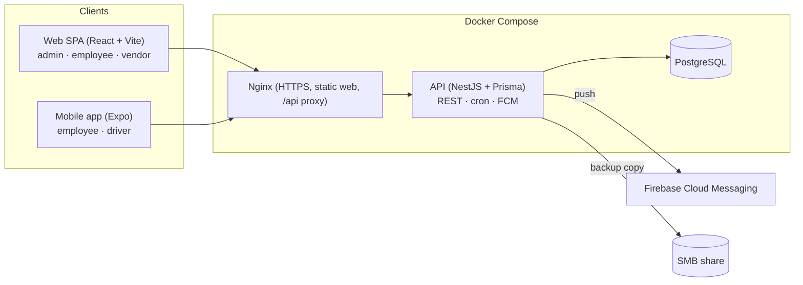

# Jalur Karyawan

**English** · [Bahasa Indonesia](README.id.md)

Jalur Karyawan (internal name: Bus Management System, BMS) schedules and books employee shuttle buses. Employees reserve seats on fixed routes per shift from the web or a mobile app, drivers check passengers in by QR code and share their GPS position, vendors see occupancy, and the GA team manages buses, routes, shifts, and trips. It is designed for one site with about 2,500 employees, 50 buses, and three shifts. The interface is in Indonesian.


## Contents

- [Features](#features)
- [Roles](#roles)
- [Architecture](#architecture)
- [Tech stack](#tech-stack)
- [Getting started on Windows](#getting-started-on-windows)
- [Running the packages manually](#running-the-packages-manually)
- [Mobile app](#mobile-app)
- [Production deployment](#production-deployment)
- [Testing](#testing)
- [Project layout](#project-layout)
- [Documentation](#documentation)
- [License](#license)

## Features

### Scheduling and booking

- Fixed routes with ordered stops and pickup time offsets. Each shift has a separate pickup (`PICKUP`) trip and drop-off (`DROPOFF`) trip, booked independently.
- Trip templates generate daily trips automatically. Admins can swap the bus or cancel a trip; affected bookings are cancelled and passengers are notified.
- Period subscriptions are the default way to ride, and daily bookings fill the remaining seats.
- Seats are a quota per trip, without seat numbers, and the booking engine never sells the same seat twice.
- Booking and cancellation close a configurable number of minutes before departure (default 120).
- When a trip is full, the request is refused and stored as a rejected request, so admins and vendors can see where capacity is short. There is no waiting list.
- Admins can freeze a user's booking rights, for example after repeated no-shows.

### Operations

- QR check-in in two directions: the driver scans the employee's ticket QR with a Zebra handheld (DataWedge) or a phone camera, or, if the handheld fails, the employee scans the bus QR code from their own booking. Both paths create one attendance record, and repeat scans return the first record instead of a duplicate.
- The check-in window runs from 60 minutes before to 90 minutes after each passenger's pickup time, based on server time. Check-in is never treated as successful while offline.
- QR payloads are random values with a type prefix (`BMS-T1:` for tickets, `BMS-B1:` for buses) and contain no IDs or personal data. Rotating a bus QR invalidates the old label.
- GPS tracking from the driver's device, refreshed every 15 seconds. A position older than 120 seconds, or from a finished trip, is shown as the last known location rather than live.
- Route map (Leaflet) where admins drag stop pins to move them, and where employees can see the stops of their route. Deleting a stop only deactivates it, so historical bookings stay intact.

### Notifications and reports

- In-app notifications and Firebase Cloud Messaging push for important events and reminders before a trip.
- Dashboard, occupancy, rejected request, no-show, and booking history reports, with CSV export of passenger lists and reports.

### Administration and safety

- Employees log in with their NIK and password, imported from Excel or CSV. The schema has an `auth_provider` field ready for SSO.
- JWT access and refresh tokens, account lockout, rate limiting, and a forced password change on first login.
- First-run setup screen that creates the Super Admin on an empty database.
- Maintenance mode that returns 503 to everyone except allowed operations.
- Backups with `pg_dump`, optional copy to an SMB share, retention, and restore with validation before anything is overwritten.
- Audit log of admin actions, with secrets masked as `***`.

## Roles

| Role | Access |
|---|---|
| `SUPER_ADMIN` | Everything, including admin accounts, settings, backup, and restore |
| `ADMIN_GA` | Buses, vendors, routes, shifts, trips, employees, reports, tracking |
| `EMPLOYEE` | Subscriptions, daily bookings, history, notifications, ticket QR, self check-in |
| `VENDOR` | Read-only view of all trips and occupancy |
| `DRIVER` | Assigned trips, passenger manifest, QR check-in, GPS sharing. Must belong to a vendor |

Admins can also use the employee self-service screens.

## Architecture



The API is split into one NestJS module per domain: `auth`, `users`, `fleet`, `routes`, `trips`, `generate`, `bookings`, `operations`, `reports`, `notifications`, `scheduler`, `settings`, `backup`, `audit`, and `admin`.

## Tech stack

| Layer | Technology |
|---|---|
| API | NestJS 11, Prisma 6, PostgreSQL, google-auth-library (FCM) |
| Web | React 18, Vite 5, Leaflet |
| Mobile | Expo, React Native, Zebra DataWedge integration |
| Shared | `@bms/shared` (Zod schemas, types, enums) and `@bms/mock-api` (MSW handlers for mock mode) |
| Tooling | pnpm workspaces, TypeScript 5.6, Vitest, Jest (mobile), Playwright |
| Deployment | Docker Compose, Nginx |

## Getting started on Windows

Requirements: Node.js 22 or newer, pnpm 10.33.2 (`npm install -g pnpm@10.33.2`), and Docker Desktop for live mode.

```bat
start.bat
```

The default live mode:

1. Starts a separate development PostgreSQL on `127.0.0.1:5434` (database `bms_dev`).
2. Generates the Prisma client and applies migrations to that database.
3. Starts the API on `http://127.0.0.1:3000` and the web app on `http://127.0.0.1:5241`, each in its own terminal window.
4. Opens the browser when both are ready.

A fresh database shows the first-run setup screen for the Super Admin; the script does not seed data. A development secret is created once in `.local/app-secret` and reused. Keep it: issued QR codes are encrypted with it.

Other options:

```bat
start.bat -Mode mock            :: UI demo without backend or Docker
start.bat -Check                :: check prerequisites only
start.bat -NoBrowser
start.bat -WebPort 5297 -ApiPort 3097 -DatabasePort 5497
```

Mock mode keeps data in browser memory and offers demo accounts: `admin`, `00012345`, and `driver`, all with the password `demo1234`. It does not prove that the backend or device GPS works.

To stop: press Ctrl+C in the API and web windows, then run `docker compose -p bms-local-dev -f scripts/compose.dev.yml stop`. Data stays in the `bms-local-dev_pgdata` volume; do not use `down -v` unless you want to delete it. [docs/start-aplikasi.md](docs/start-aplikasi.md) has the full guide.

## Running the packages manually

```bash
pnpm install --frozen-lockfile
pnpm --filter @bms/api dev        # API (Nest watch mode)
pnpm --filter @bms/web dev        # web (Vite)
pnpm test                         # all workspace tests
pnpm typecheck                    # all workspace type checks
```

The web basemap is configured at build time:

```dotenv
VITE_MAP_TILE_URL=https://your-licensed-provider.example/{z}/{x}/{y}.png
VITE_MAP_ATTRIBUTION=Your licensed provider attribution
```

## Mobile app

`apps/mobile` is an Expo app for the `EMPLOYEE` and `DRIVER` roles.

```bash
cd apps/mobile
cp .env.example .env      # EXPO_PUBLIC_USE_MOCK=true for the mock API
pnpm install
pnpm test
npx expo start
```

Point it at a real backend with `EXPO_PUBLIC_API_URL=https://bus.example.com`; the URL is fixed at build time. Remember that `127.0.0.1` on a phone is the phone itself. Internal APK builds use EAS; see [apps/mobile/README.md](apps/mobile/README.md) and [docs/mobile-todo.md](docs/mobile-todo.md).

## Production deployment

```bash
cd infra
./install.sh                          # writes .env (APP_SECRET, POSTGRES_PASSWORD) and a self-signed TLS certificate
cd .. && pnpm --filter @bms/web build # nginx serves apps/web/dist
cd infra && docker compose up -d --build
```

The stack runs PostgreSQL, the API, and Nginx, published on `HTTP_PORT` (default 80) and `HTTPS_PORT` (default 443). For internet access, replace `infra/certs/server.crt` and `server.key` with a real certificate.

Demo data for a fresh database (this wipes all data and refuses to run if a Super Admin already exists unless you add `--force`):

```bash
docker compose exec api sh -c 'cd apps/api && npx tsx prisma/seed.ts'
docker compose exec api sh -c 'cd apps/api && npx tsx prisma/seed.ts --scale'   # load-test set: 20 routes, 50 buses, 2,500 employees
```

Never expose the Windows development launcher to the internet.

## Testing

```bash
pnpm test                                  # Vitest in api, web, shared, mock-api; Jest in mobile
pnpm --filter @bms/web e2e                 # Playwright end-to-end tests
pnpm --filter @bms/web test:api            # Playwright smoke test against the live API
```

`docker-compose.test.yml` provides the database for API integration tests.

## Project layout

```
apps/
  api/              NestJS API, Prisma schema and migrations, seed, demo fixture
  web/              React + Vite SPA (admin, employee, vendor screens), Playwright e2e
  mobile/           Expo app (employee and driver), DataWedge module
packages/
  shared/           Zod schemas, types, enums
  mock-api/         MSW handlers for mock mode
infra/              production docker-compose, nginx.conf, install.sh
scripts/            Windows launcher (start.ps1) and dev database compose file
docs/               design specs, operations notes, demo guides
```

## Documentation

- [docs/superpowers/specs/2026-10-13-bus-booking-subproject-a-design.md](docs/superpowers/specs/2026-10-13-bus-booking-subproject-a-design.md): design specification
- [docs/operations-maps-checkin.md](docs/operations-maps-checkin.md): maps, check-in, and tracking
- [docs/start-aplikasi.md](docs/start-aplikasi.md): running the app on Windows
- [docs/demo-karawang.md](docs/demo-karawang.md): optional synthetic demo data for the local database

## License

This repository does not include a license file. Contact the author before reusing the code.

Developed by Yohanes Octavian Rizky ([@torpedoliar](https://github.com/torpedoliar)).
